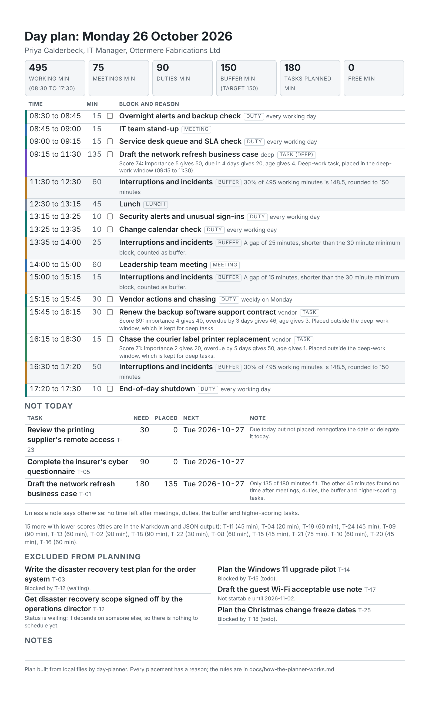
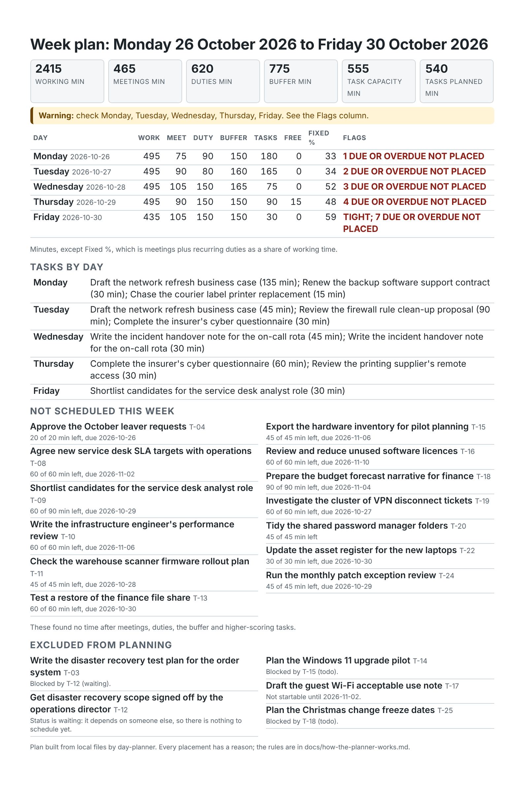

# it-manager-day-planner

[](https://github.com/pJijesh/it-manager-day-planner/actions/workflows/test.yml) [](LICENSE)  

**Problem:** an IT manager's day is booked solid with meetings and routine checks before any real work starts, and then an incident takes the rest, so the plan is wrong by mid-morning, the important work slips quietly and nobody can see what was traded away.

**For:** IT managers and heads of IT in small and mid-size organisations who run a team, a service desk and a handful of projects at once.

**Demonstrates:** a practical operating rhythm (what to check and do daily, weekly, monthly, quarterly and annually), printable templates, and a small standard-library Python tool with a documented, deterministic scheduling model that builds a time-blocked day or week from recurring duties, fixed meetings and a task list, protects time for interruptions and gives a plain-English reason for every placement.

All organisations, people and figures in the example are fictional: "Ottermere Fabrications Ltd" and its IT manager are invented, and any resemblance to a real business is accidental. The example figures are not benchmarks.



> The operating rhythm is a set of practitioner suggestions to adapt, not a standard. Nothing in this repository states that a law, regulation or standard requires a particular frequency for any activity. Where a rule applies to you, follow that source.

## What it does

- **Operating rhythm** (`data/operating-rhythm.json`, [`docs/operating-rhythm.md`](docs/operating-rhythm.md)): 40 suggested items across five cadences (8 daily, 9 weekly, 8 monthly, 8 quarterly and 7 annual), each with a reason and a typical time in minutes. `day-planner rhythm` prints it as a checklist.
- **Templates** (`templates/`): seven short, printable Markdown templates: daily plan, end-of-day shutdown checklist, weekly review, one-to-one note, decision log entry, incident handover note and monthly leadership update.
- **Guides** (`docs/`): [how the planner works](docs/how-the-planner-works.md) (the exact scheduling model), [time blocking for IT managers](docs/time-blocking-for-it-managers.md) (protecting deep work, planning for interruptions, saying no, delegation, backlogs and what to do when the plan collapses) and [getting started](docs/getting-started.md).
- **Planner tool** (`python -m day_planner`), which reads two local files and writes only what you ask for:
  - `init`: writes a starter `profile.json`, `tasks.csv` and a short README.
  - `plan`: builds one day as Markdown, JSON or a single-page A4 HTML sheet with checkboxes. Working hours, lunch, a protected interruption buffer shown as explicit "interruptions and incidents" blocks, fixed meetings, recurring duties (daily, weekdays, weekly, monthly by day, last working day or nth weekday, quarterly, annual, with bank holidays), and tasks ranked by a documented score. Anything that does not fit goes under "Not today" with a reason and a suggested next day, and the tool warns plainly when fixed commitments already exceed capacity.
  - `week`: Monday to Friday in one table that flags overloaded and tight days, with long tasks carried forward and optional per-day plans.
  - `rhythm`: prints the operating-rhythm checklist.
  - `review`: a weekly review sheet with done, rolled over, overdue and waiting items, and planned task capacity against recorded output.
- **Worked example** (`examples/`): a fictional organisation with a profile, a 26-task list (some blocked, some overdue, some deep work), and the plans for a normal Monday, an incident-heavy day, a month-end Friday and the week, in Markdown, HTML and JSON.

## Quick start

Requires Python 3.10 or later. No third-party packages.

```bash
pip install -e .          # optional: gives the day-planner command. python -m day_planner works from a checkout

# 1. A starter workspace you can edit
python -m day_planner init my-planner

# 2. Plan a normal Monday from the worked example
python -m day_planner plan --profile examples/profile.json --tasks examples/tasks.csv --date 2026-10-26

# 3. The same day as a printable A4 page, then an incident day with a 50 percent buffer
python -m day_planner plan --profile examples/profile.json --tasks examples/tasks.csv --date 2026-10-26 --format html --out plan.html
python -m day_planner plan --profile examples/profile.json --tasks examples/tasks.csv --date 2026-10-27 --buffer 50

# 4. The week, and the review of it
python -m day_planner week   --profile examples/profile.json --tasks examples/tasks.csv --start 2026-10-26
python -m day_planner review --profile examples/profile.json --tasks examples/tasks-friday-snapshot.csv --week-start 2026-10-26

# 5. The operating-rhythm checklist
python -m day_planner rhythm --cadence weekly
```

With `--out` the tool writes the file and prints a one-line summary. From the example run:

```text
Monday 26 October 2026: 495 working min, 75 meetings, 90 duties, 150 buffer, 180 tasks planned, 18 not today.
Tuesday 27 October 2026: 495 working min, 90 meetings, 80 duties, 250 buffer, 65 tasks planned, 19 not today.
Week from Monday 26 October 2026: 540 of 555 task minutes planned, 13 task(s) not scheduled.
Review for the week of 2026-10-26: 8 done, 5 rolled over, 1 overdue.
```

The printable page for the normal Monday (`examples/output/plan-monday.html`), rendered with Chromium:



The week overview (`examples/output/week-overview.html`) flags where fixed commitments leave little room:



Bad input stops the run with every problem listed (with line numbers) and exit status 2, for example `tasks.csv: circular blocking: A -> C -> B -> A` or `working_hours.mon: '9am' is not a 24-hour time, use HH:MM such as 09:00`. See [`examples/README.md`](examples/README.md) for what each committed output shows.

## How it is built

```text
.
├── README.md
├── LICENSE                          MIT
├── CONTRIBUTING.md
├── pyproject.toml                   Console entry point day-planner, no dependencies
├── data/
│   └── operating-rhythm.json        40 suggested rhythm items in five cadences
├── docs/
│   ├── how-the-planner-works.md     The scheduling model, precisely
│   ├── time-blocking-for-it-managers.md
│   ├── operating-rhythm.md          Generated from the JSON by scripts/build_rhythm_doc.py
│   ├── getting-started.md
│   └── images/                      Mermaid sources, rendered SVG and the screenshots
├── templates/                       Seven printable Markdown templates
├── day_planner/                     The Python package
│   ├── cli.py                       init, plan, week, rhythm and review commands
│   ├── profile.py, tasks.py         Loading and validating profile.json and tasks.csv
│   ├── recurrence.py                When a recurring duty falls (month ends, nth weekday, holidays)
│   ├── scoring.py                   The task score and tie-break
│   ├── scheduler.py                 Capacity, buffer, duty and task placement for one day
│   ├── week.py, review.py           Week plan with carry-over, and the weekly review
│   ├── render_md.py, render_html.py, render_json.py
│   ├── rhythm.py, scaffold.py       Rhythm checklist and the init command
│   └── timeutil.py, model.py, errors.py
├── examples/                        Fictional inputs and every generated output
├── scripts/                         regenerate_examples.py, build_rhythm_doc.py, make_screenshot.py
├── tests/                           pytest suite
└── .github/workflows/test.yml
```

## Design choices

- **The buffer is a block, not a feeling.** Thirty percent of working time is reserved by default and shown as "interruptions and incidents" blocks, spread through the day and kept outside the deep-work window where it can. The figure is a starting value to tune from your own tally, not a finding.
- **Every placement has a reason.** Scores, the slot chosen, splits, exclusions and rejections are written out in words, so a plan can be challenged and corrected instead of trusted.
- **A simple, checkable score.** Importance, urgency and age are added as whole numbers, with a fixed tie-break, so any score can be worked out by hand. The weights are a choice and live at the top of one file.
- **Deep work is protected, not hoarded.** Only deep tasks use the window in the first pass, and what they leave is released to other tasks in a second pass.
- **Minimum block length.** Gaps below it count as buffer and no task piece is shorter, except a task that is itself shorter, so the day is not shredded into fragments.
- **Say no early.** Anything that does not fit is named under Not today with a next day and, if it is already due, a prompt to renegotiate, delegate or drop it.
- **Deterministic.** No clock, no network, no random choices and no timestamps, so outputs are byte-stable and a test compares a fresh run with every committed example.
- **Local files only, no dependencies.** The HTML has no JavaScript and no external resources, and all text is escaped.

## Limitations

- It does not sync with any calendar or ticketing system. It reads local files only, so keeping the profile and the task list current is manual.
- A plan is only as good as its inputs. Estimates, importance ratings and the fixed meetings are yours, and the tool cannot know how long things really take.
- The operating rhythm is generic. It was written from practitioner judgement for a typical small or mid-size organisation and needs adapting to yours. It is not a standard and makes no claim about what any regulation requires.
- The scheduling model is deliberately simple. It plans a single person's day in whole minutes, places tasks greedily by score, does not optimise across days beyond carrying work forward, and does not model energy, travel time, time zones or other people's availability.
- The printable HTML aims for one A4 page. A day with unusually many blocks or long reasons can run to a second page, and the page lists only the highest-scoring tasks under Not today (the Markdown and JSON list all).
- The weekly review has no time tracking. Recorded output uses `actual_minutes` where you enter it and the estimate otherwise, and interruption time lost is left for you to fill in.
- Bank holidays are whatever you list. The example uses the England and Wales dates for 2026.
- `data/operating-rhythm.json` is found beside the package in a checkout or editable install, or in `./data`; a regular installed copy needs `--file`.
- The example is one invented organisation and does not represent any real one.

## Verification status

- Every command in this README was run, and the example outputs were produced by those commands. The tests cover the recurrence rules (last working day, nth weekday, month end, a leap day and holidays), capacity and buffer arithmetic with hand-computed values, scores and tie-breaks, blocked and earliest-start handling, splitting rules, overflow and warnings, HTML escaping (including a task title containing script tags), input validation messages, determinism, the CLI, a full run on the worked example compared byte for byte with every committed output, and repository hygiene (no long dashes, working Markdown links).
- The printed page count of the four example HTML files was checked with Chromium: each fits one A4 page. The screenshots were taken with Playwright at a device scale factor of 2 and looked at.
- The diagrams were rendered with the Mermaid CLI and checked by eye.
- The England and Wales bank holiday dates for 2026 in the example profile were checked against the GOV.UK bank holidays data.
- No claim is made that any frequency in the operating rhythm is required by a law, regulation or standard, and no primary source was relied on for the rhythm.
- The tool has been run only on the fictional example and on synthetic test input, not in a real working week. It was run on Python 3.13 here. The CI matrix covers 3.10 to 3.13 and was not run from this environment.
- The light theme, the print layout and the dark colour scheme (`prefers-color-scheme`) of the HTML were each looked at in Chromium. The HTML was not opened in other browsers.

## Roadmap

Planned, not promised. Order and timing change with other work.

- **Next:** Release v1.0 after a final read-through; Add iCalendar export of the day plan
- **Then:** Add a second operating rhythm profile for small teams; Add incident day planning guidance and example
- **Later:** Add weekly review trend summary; Release v1.1

## Licence

[MIT](LICENSE), 2026 Jijesh Puliyappottammal. See [CONTRIBUTING](CONTRIBUTING.md) for how to suggest changes.

Built by [Jijesh Puliyappottammal](https://www.linkedin.com/in/pjijesh), an IT manager. [GitHub](https://github.com/pJijesh)
