# How the planner works

This page defines the scheduling model exactly. The aim is that anyone can check a plan by hand and understand every placement. Every block in the output carries a plain-English reason, and the rules below are the source of those reasons.



The planner is deterministic: the same profile, task list, date and options always give byte-identical output. It never reads the clock, makes no network calls and uses no random choices. All times are whole minutes.

## 1. Inputs

### profile.json

| Field | Meaning | Default |
|---|---|---|
| `name`, `organisation` | Shown in the heading. Optional text. | empty |
| `working_hours` | Start and end per weekday (`mon` to `sun`) as `["08:30", "17:30"]`, or `null` for a day off. At least one day is required. | none |
| `lunch` | `{"start": "12:30", "end": "13:15"}`, or `null` for none. | none |
| `buffer_percent` | Share of working time protected for interruptions and incidents, 0 to 90. | 30 |
| `min_block_minutes` | Shortest block a task may be given, 5 to 240. | 30 |
| `buffer_block_minutes` | Target length of one interruption block, 15 to 240. | 60 |
| `deep_work_window` | `{"start": "09:15", "end": "11:30"}`, or `null`. | none |
| `fixed_meetings` | Each has a `title`, `start`, `end` and exactly one of `weekday`, `weekdays` (a list) or `date`. | empty |
| `recurring_duties` | See section 2. | empty |
| `bank_holidays` | A list of `YYYY-MM-DD` dates. Nothing is looked up online. | empty |

Fields that start with an underscore are ignored, so a profile can carry comments. Unknown fields are an error, which catches typos such as `working_hrs`.

### tasks.csv

Required columns: `id`, `title`, `estimate_minutes`. Optional columns:

| Column | Meaning | Default |
|---|---|---|
| `category` | Free text. The value `deep` marks work that needs unbroken focus. | `general` |
| `due` | `YYYY-MM-DD`. | none |
| `importance` | Whole number 1 to 5, 5 highest. | 3 |
| `status` | `todo`, `in_progress`, `waiting`, `done` or `cancelled`. | `todo` |
| `blocked_by` | Task ids separated by semicolons, commas or spaces. | none |
| `earliest_start` | `YYYY-MM-DD`. The task is not planned before this date. | none |
| `created` | `YYYY-MM-DD`, used for the age points. | none |
| `completed`, `actual_minutes` | Used only by the weekly review. | none |

Extra columns are ignored. Problems are collected and reported together with line numbers: bad times and dates, unknown ids in `blocked_by`, a task blocked by itself, circular blocking (the chain is printed), duplicate ids, and fixed meetings that overlap on a day they could both fall on.

## 2. Recurring duties

A duty has `title`, `minutes`, a `cadence`, an optional `preferred_start` and an optional `id`.

| Cadence | Extra fields | Falls on |
|---|---|---|
| `daily` | none | every working day |
| `weekdays` | `weekdays`: list | the listed weekdays |
| `weekly` | `weekday` | that weekday |
| `monthly_day` | `day` (1 to 31) | that day of the month |
| `monthly_last_working_day` | none | the last working day of the month |
| `monthly_nth_weekday` | `nth` (1 to 5, or -1 for last), `weekday` | for example the 2nd Wednesday |
| `quarterly` | `months` (default 1, 4, 7, 10) plus one day rule | the day rule, in those months |
| `annual` | `month` plus one day rule | the day rule, in that month |

A day rule is exactly one of `day`, `last_working_day: true`, or `nth` with `weekday`.

Rules for dates:

- A **working day** is a weekday with working hours in the profile that is not in `bank_holidays`.
- `daily`, `weekdays` and `weekly` duties simply do not run on a non-working day.
- Month-based duties find a nominal date and, if it is not a working day, move to the next working day (default) or the previous one (`"if_not_working": "previous"`). The move can cross a month boundary, and the planner checks the neighbouring months so a shifted duty is still found.
- A day number larger than the month is clamped to the last day of the month. Day 31 in April is 30 April. Day 29 in February is 28 February in a common year, and 29 February in a leap year.
- `nth: 5` in a month with only four of that weekday gives no occurrence that month. Use `-1` for "the last".
- The last working day is found by walking back from the last calendar day of the month, skipping weekends, days without working hours and bank holidays.

## 3. Capacity arithmetic

For a working day with hours `S` to `E`:

1. **Working minutes** `W = (E - S) - lunch`, where lunch is the configured lunch clipped to the working hours. Example: 09:00 to 17:00 is 480, lunch 12:00 to 13:00 is 60, so `W = 420`.
2. **Meeting minutes** `M`: each fixed meeting that applies to the day, clipped to working hours, minus any part inside lunch. A meeting outside working hours is ignored with a warning. A meeting that overlaps lunch shortens the lunch (warning) and does not reduce working capacity.
3. **Duty minutes** `D`: the duties due that day that could be placed.
4. **Buffer target** `B = round5(W x buffer_percent / 100)`, using exact fractions and rounding half up to the nearest 5 minutes. For `W = 420` and 30 percent, 126 rounds to 125. For `W = 495`, 148.5 rounds to 150.
5. Free time after meetings, lunch and duties is `F = W - M - D`. Everything that remains after the buffer is **task capacity** `F - buffer`.

The identity `W = M + D + buffer + tasks planned + free` holds for every working day, and the tests check it.

## 4. The order of work

1. **Meetings** are placed exactly where the profile says. **Lunch** is the part of the lunch window not covered by a meeting.
2. **Duties** are placed in the free time. Duties with a `preferred_start` go first, in order of that time; others follow in file order. A duty takes its preferred start if free. Otherwise it takes the earliest free time after it where it fits. If nothing fits after it, it takes the latest start before it that fits (so an end-of-day duty on a short Friday still lands at the end). A duty is never split. If it cannot be placed, an alert says so.
3. **Short gaps.** Free gaps shorter than `min_block_minutes` cannot hold a task. They are shown as interruptions and incidents ("a gap of 25 minutes ... counted as buffer") and count towards the buffer target.
4. **Buffer.** The rest of the target is reserved from the usable free time, shown as explicit **Interruptions and incidents** blocks:
   - The pool is the usable free time outside the deep-work window. If that is smaller than what is needed, the pool is all usable free time, and the block says so.
   - The reserve is cut into `m = ceil(reserve / buffer_block_minutes)` parts, in multiples of 5 minutes where possible, earlier parts larger.
   - Part `i` (counting from 0) is assigned to the free interval that contains point `(2i + 1) x n / (2m)` of the pool laid end to end, where `n` is the pool length. This spreads the buffer through the day in proportion to the free time.
   - Each interval gives up one block taken from its **end**, because interruptions tend to land just before the next fixed commitment. If a block would leave a remainder shorter than the minimum block, the whole interval is taken and later blocks shrink so the total stays the same. Overflow moves to the next interval.
   - Any remainder shorter than the minimum block that is left beside a buffer block is also counted as buffer. The buffer shown can therefore be slightly above the target, and the reason says why.
5. **Eligibility** (section 5), **scoring** (section 6), then **placement of tasks** (section 7).
6. **Leftovers**: anything that did not fit is listed under **Not today**, and free time that no task could use is shown as free, unplanned.



## 5. Which tasks are eligible

A task is left out of the plan, with a reason, if any of these hold:

- `status` is `done` or `cancelled`: ignored silently (they are counted in the JSON).
- `status` is `waiting`: "depends on someone else, so there is nothing to schedule yet".
- It is blocked: any id in `blocked_by` that is not `done` or `cancelled`. The reason names each blocker and its status.
- `earliest_start` is after the plan date. The reason gives the date.

These appear under **Excluded from planning**. Everything else is eligible, including `in_progress` tasks.

## 6. The score

```
score = importance points + urgency points + age points
```

| Part | Rule |
|---|---|
| Importance | 10 x importance, so 10 to 50 |
| Urgency, overdue by n days | 40 + min(20, 2 x n), so 41 to 60 |
| Urgency, due today | 40 |
| Urgency, due in n days | max(0, 40 - 5 x n): 35 tomorrow, 5 in a week, 0 from 8 days away |
| Urgency, no due date | 0 |
| Age | 1 point per full 7 days since `created`, capped at 10 |

Days are calendar days. These weights are a design choice, not a finding. They make overdue work rank above anything due today, and importance rank above a close but unimportant deadline. A critical task with no due date (50 points) ties with an unimportant task due today (10 + 40). If your priorities differ, change the constants at the top of `day_planner/scoring.py` and the tests will show what moves.

**Worked example.** Importance 5, due in 4 days, created 30 days ago: 50 + (40 - 20) + 4 = 74. Importance 4, overdue by 3 days, created 22 days ago: 40 + (40 + 6) + 3 = 89.

**Tie-break**, in order: earlier due date (none last), higher importance, shorter estimate, then the id in natural order (T-2 before T-10). Two tasks never tie completely because ids are unique.

## 7. How tasks are placed

Tasks are taken in score order. Each task uses the first rule that applies.

**Zones.** The usable free time is split into the part inside the deep-work window and the part outside it.

1. **Pass one.** A task whose category is `deep` tries the deep-work window first, then the time outside it. Any other task uses only the time outside the window.
2. **Pass two.** Tasks that still have minutes left, other than deep tasks, may use whatever is left in the deep-work window. The window is protected for deep tasks, and not wasted if they do not need it.

**Within a zone.**

- If one free gap holds the whole task, the task takes the start of the **earliest** such gap, as a single block.
- Otherwise the task is split across gaps, earliest first. Every piece must be at least `min_block_minutes`, and a split never leaves a final piece shorter than that. If the remaining time is less than twice the minimum, the task is not split.
- A task shorter than the minimum block is never split and takes a single block of its own length, in any gap that holds it.
- A task can be placed partly. The unplaced remainder goes to Not today.

Blocks of one split task are labelled "part 1 of 2" and so on, and the reason says why it was split.

## 8. Not today and suggested next day

Each eligible task with minutes left is listed with the minutes needed, the minutes placed, its score, the reason and a suggested next day.

- Reasons: no time left after meetings, duties, the buffer and higher-scoring tasks; or the largest free gap left is too small for it.
- The suggested next day is the next working day (week plans point at the day the task is planned instead, if it is).
- A task that is overdue or due today and was not placed gets a note: renegotiate the date, delegate it or drop it, rather than letting it slide again.

## 9. Warnings

| Level | When |
|---|---|
| Alert | Fixed commitments (meetings plus all duties due) exceed `W`: "OVERLOADED", with the shortfall. A duty could not be placed. |
| Warning | Fixed commitments leave no more than the buffer target (no task time). A meeting is outside working hours, or overlaps lunch, or covers all of it. The deep-work window has less than one minimum block free while deep tasks are waiting. |
| Note | The date is not a working day. The buffer was overridden with `--buffer`. |

## 10. The week plan

`week` plans Monday to Friday by running the day plan five times. Minutes placed on one day are taken off the task before the next day, so a long task carries forward. A task whose blockers are all `done` or fully scheduled on an earlier day becomes eligible on the next day, and its reason says it assumes the blocker is done. The overview table gives per day working time, meetings, duties, buffer, tasks, free time and the share of working time taken by fixed commitments, with flags:

| Flag | Meaning |
|---|---|
| OVERLOADED | Fixed commitments exceed working time |
| NO TASK TIME | Working time minus fixed commitments minus the buffer target is zero or less |
| TIGHT | That remainder is under two minimum blocks |
| N DUE OR OVERDUE NOT PLACED | Tasks due or overdue that day that were not placed that day and are not planned later in the week |
| DUTY NOT PLACED | A recurring duty had no gap |
| NOT A WORKING DAY | Weekend or bank holiday |

The week must start on a Monday.

## 11. The weekly review

`review` needs no time tracking. For the week it reports:

- **Capacity**: working, meeting, duty and buffer minutes, and the minutes left for tasks, from the profile alone.
- **Done**: tasks with status `done` and a `completed` date in the week, with `actual_minutes` where recorded, else the estimate (marked). The output is compared with task capacity.
- **Rolled over**: open tasks due in the week, and open tasks in progress that are not already overdue.
- **Overdue**: open tasks due before the week.
- **Waiting or blocked**, and **due next week**.

Interruption time actually lost is left as a blank to fill in by hand, because the tool cannot know it.

## 12. What the model does not do

It does not know how long things really take, whether a meeting will run over, or what a given day will throw at you. Estimates and importance ratings are yours. The plan is a starting position for a conversation with yourself, and the buffer exists because it will be wrong. See [time blocking for IT managers](time-blocking-for-it-managers.md) for what to do when it is.
